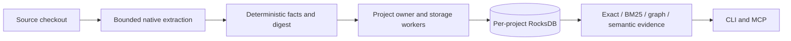

<div align="center">

# Cartograph

**Cartograph 3.0 — current code intelligence, stored with your project.**

Native Rust CLI and MCP server · per-project RocksDB · code-aware BM25 · typed code graph

[](https://github.com/adder-factory/cartograph/releases/latest)
[](https://github.com/adder-factory/cartograph/actions/workflows/v2-rust.yml)
[](LICENSE)
[](https://www.rust-lang.org/)

**[Quick start](#quick-start)** · [Agent workflow](#agent-workflow) ·
[Languages](docs/SUPPORT-MATRIX.md) · [Architecture](#architecture) ·
[Documentation](docs/README.md) · [Changelog](docs/RELEASES.md)

</div>

---

Cartograph turns a source checkout into a searchable, immutable-generation code
graph. It gives coding agents compact evidence about declarations, references,
call flow, change impact, affected tests, and source freshness through one native
CLI and the [Model Context Protocol](https://modelcontextprotocol.io/).

The source checkout remains the source of truth. Every evidence packet carries
generation provenance, freshness, confidence, truncation, and explicit
abstention instead of presenting stale or incomplete data as certainty.

> [!IMPORTANT]
> Version 3.0 replaces PostgreSQL with embedded RocksDB. Each project owns its
> database, and a persistent native service keeps its graph current. Existing
> v2 projects need a source rebuild and host restart; see [Upgrade](#upgrade).

## Start here

| I want to… | Go to |
| --- | --- |
| Install Cartograph and build a first graph | [Quick start](#quick-start) |
| Hand setup to a coding agent | [Agent-assisted installation](docs/AGENT-INSTALL.md) |
| Connect Codex, Claude Code, Cursor, or another host | [MCP usage](docs/MCP-USAGE.md) |
| Look up a command, flag, or JSON field | [CLI reference](docs/CLI-REFERENCE.md) |
| Check a language, extension, or framework | [Language support matrix](docs/SUPPORT-MATRIX.md) |
| Inspect and maintain native storage | [Storage and operations](docs/STORAGE-BACKENDS.md) |
| Fix a failed setup, error code, or stale graph | [Troubleshooting](docs/TROUBLESHOOTING.md) |
| See what changed in each release | [Changelog](docs/RELEASES.md) |
| Browse every guide by task | [Documentation home](docs/README.md) |

## What Cartograph gives an agent

| Question | Evidence |
| --- | --- |
| Where is this declared or referenced? | Exact symbol, path, reference, and identifier lookup |
| Which code is most relevant? | Code-aware BM25 over names, implementation identifiers, and documentation |
| What calls this, and what does it call? | Typed callers, callees, imports, references, and shortest paths |
| What could this change affect? | Bounded reverse impact and structurally connected tests |
| Where is numerical behavior risky or statically unknown? | Generation-scoped Rust operation/hazard/precision sites with exact spans and explicit evidence limits |
| Is the graph current? | Immutable generation identity and exact supported-source freshness |
| What changed in the working tree? | Separately labeled live overlay and Git-ref review packets |
| Is an LLM required? | No for exact, lexical, graph, review, freshness, or affected-test workflows |

Cartograph also supports standard SCIP export, persistent per-file SCIP overlays,
model-scoped semantic retrieval, generated artifacts with explicit provenance,
and deterministic task-intent routing.

## Quick start

> [!TIP]
> Prefer agent-assisted setup? Give your coding agent the copy-paste task in
> [Agent-assisted installation](docs/AGENT-INSTALL.md).

### 1. Install the native executable

macOS (Apple Silicon, macOS 26+) or Linux (ARM64/x64, glibc 2.41+):

```sh
curl -fsSL https://raw.githubusercontent.com/adder-factory/cartograph/main/install.sh | sh
cartograph --version
```

Windows (x64), in PowerShell:

```powershell
irm https://raw.githubusercontent.com/adder-factory/cartograph/main/install.ps1 | iex
cartograph --version
```

The installer verifies the archive against the release's `SHA256SUMS`. To build
from source, use the pinned Rust toolchain, a C/C++ compiler, and libclang:

```sh
cargo build --locked --release -p cartograph-cli
```

### 2. Build the first graph

```sh
cd /path/to/project
cartograph index .
cartograph doctor . --format json
cartograph status . --format json
cartograph context 'explain the primary request flow' --project-path .
```

Each project owns `.cartograph/data`; no server or Docker bootstrap is needed.
An unchanged second index skips publication. Require a fresh generation and
real retrieval evidence before calling setup ready. Doctor reports native
capabilities separately from freshness, models, registration, and transport.

For a previously indexed PostgreSQL project, run
`cartograph db migrate --to rocksdb --project-path .` to rebuild and verify the
native destination while preserving legacy data. See the
[migration guide](docs/v2/ROCKSDB-MIGRATION.md) for the scope of that rebuild.

### 3. Connect a coding agent

Cartograph writes project-scoped MCP configuration and pins the absolute native
executable path. For Claude Code the project entry lives under
`projects.<path>.mcpServers` in `~/.claude.json`, Claude's local scope.

```sh
cartograph install --yes --target codex  --location local --project-path .  # OpenAI Codex
cartograph install --yes --target claude --location local --project-path .  # Claude Code
cartograph install --yes --target cursor --location local --project-path .  # Cursor
```

The installer supports 19 hosts in total; see the
[CLI reference](docs/CLI-REFERENCE.md#mcp-and-agent-configuration) for every
target ID.


### 4. Verify the live integration

A setup is ready only after all four signals pass:

1. `cartograph doctor` proves database capabilities.
2. `cartograph index` publishes one complete generation.
3. `cartograph status` reports that generation as fresh.
4. A real `find` or `context` query returns generation-scoped evidence.

A CLI request proves the executable and database path. After restarting an
agent host, make one live MCP request as the separate transport-health check.
Until that happens, `doctor` deliberately reports `liveTransport` as
`not_checked`; an on-disk registration never proves which child process an
already-running host loaded.

### Keep the graph current

On macOS, start a project service that stays alive when an MCP client
disconnects:

```sh
cartograph service start --project-path . --format json
cartograph service status --project-path . --format json
```

Filesystem events use a 150 ms quiet window and incremental file parsing.
Continuous edits are coalesced for at most two seconds, and a periodic source
check catches missed events. These are scheduling bounds; end-to-end freshness
also includes extraction, publication, and the query. Check `autoSync` and
generation freshness instead of assuming every repository updates in a second.
On Linux, run `cartograph watch --project-path .` under your user service
manager, or in the foreground. Automatic service registration currently uses
macOS launchd. On Windows, the serving MCP primary owns the watcher.

### Upgrade

For an existing v2 installation, install v3 with the installer above, then run
the v3 executable:

```sh
cartograph db migrate --to rocksdb --project-path . --format json
cartograph upgrade --apply --project-path . --json
```

Migration rebuilds the graph from current source and verifies retrieval before
recording completion. It preserves the old PostgreSQL database. Legacy notes,
sessions, embeddings, and artifacts are not imported; keep the old data if you
need them. The upgrade repairs recognized host pins and reports any remaining
manual steps. Reopen attached coding hosts to load v3, then verify live MCP
status and a real query. Future native upgrades use the same `upgrade --apply`
command after stopping the existing owner. For a macOS native service:

```sh
cartograph service stop --project-path . --format json
cartograph upgrade --apply --project-path . --json
cartograph service start --project-path . --format json
cartograph status . --format json
```

For a manually managed owner, stop that project's `watch` or serving process
cooperatively, upgrade, then start it again through its service manager. Start
the new owner before reconnecting MCP hosts. Verify the status report's version
as well as the client's `--version`; a new client can still proxy to an older
owner. See the [migration guide](docs/v2/ROCKSDB-MIGRATION.md).

## Platform and database support

RocksDB is compiled into the Rust executable on macOS, Linux, and Windows.
One primary owns each project's database. macOS/Linux clients can reuse a
running MCP owner through private same-user Unix IPC. Windows currently requires
closing the existing primary before another process opens that project.
PostgreSQL connection flags and managed-container operations are retired.

See [storage operations](docs/STORAGE-BACKENDS.md) for concurrency, maintenance,
source-rebuild migration, and current capacity limits.

## Agent workflow

A reliable coding loop starts with freshness, narrows with structural evidence,
and closes with impact-aware verification:

```sh
cartograph status .                                              # 1. is the graph fresh?
cartograph context 'fix authentication token validation' --project-path .   # 2. task evidence
cartograph find 'validateToken' --by name --project-path .       # 3. exact anchor
cartograph graph <symbol-id> --direction impact --project-path . # 4. blast radius
cartograph affected --symbol-id <symbol-id> --project-path .     # 5. tests to run
cartograph review --ref main --project-path .                    # 6. review the diff
```

If status is stale, run `cartograph index .` or use the bounded MCP admin action.
Indexing unchanged source is a no-op; changed source publishes a complete new
generation atomically.

### Core MCP tools

| Tool | Purpose |
| --- | --- |
| `cartograph_status` | Current generation, counts, capability readiness, and freshness |
| `cartograph_find` | Exact name/path/reference lookup or code-aware BM25 |
| `cartograph_context` | Intent-aware evidence, graph context, and edit candidates |
| `cartograph_entry_points` | Routes, commands, MCP tools, exports, and API boundaries |
| `cartograph_graph` | Callers, callees, reverse impact, paths, and symbol similarity |
| `cartograph_affected` | Bounded affected-test selection |
| `cartograph_numerical` | Generation-scoped static numerical hazards, coverage, explanations, and non-executing probe plans |
| `cartograph_review` | Git-ref plus staged, unstaged, and untracked evidence |
| `cartograph_admin` | Explicit index, sync, embedding, and maintenance jobs |

MCP profiles are `coding`, `core`, `full`, `read-only`, and `review`. Profiles
are immutable authorization ceilings with deterministic tool lists; a narrower
profile cannot call hidden tools. Cartograph supports modern stateless MCP
`2026-07-28` plus the legacy `2024-11-05` initialize path. Modern hosts should
cache the stable complete catalog and dynamically place only task-relevant
schemas in the model context; the server does not mutate tools per connection.
See [MCP usage](docs/MCP-USAGE.md#modern-protocol-and-dynamic-tool-selection).

<details>
<summary>CLI surface — selected high-use forms</summary>

These are selected high-use forms, not the complete command inventory. Run
`cartograph --help` for the installed binary or see the
[CLI reference](docs/CLI-REFERENCE.md) for every top-level command.

```text
cartograph index [PROJECT]
cartograph status [PROJECT]
cartograph find <QUERY> --by auto|name|content|env|sql|build|path|reference|bm25|hybrid \
  [--format text|json]
cartograph context <TASK> [--exact-name NAME] [--exact-path PATH] [--exact-reference TEXT]
cartograph entry-points [--bucket public-exports] [--limit 20]
cartograph graph <SYMBOL_ID> --direction callers|callees|both|impact
cartograph graph <SYMBOL_ID> --direction path --to <TARGET_SYMBOL_ID>
cartograph graph <SYMBOL_ID> --direction similar --k 5 --min-score 0.3
cartograph affected [CHANGED_FILE ...] --max-nodes 40
cartograph affected --symbol-id <SYMBOL_ID> --max-nodes 40
cartograph review --ref <GIT_REF>
cartograph serve --mcp [--profile coding|core|full|read-only|review]
cartograph doctor [PROJECT]
cartograph db <COMMAND>
cartograph install --yes --target <HOST>
cartograph uninstall --target <HOST> [--location local]
```

Text output is optimized for concise human diagnostics. JSON is the stable
automation surface where exposed by command help.

</details>

## Large codebases and indexing

Extraction uses bounded native workers and deterministic reduction. The
`maxGenerationBytes` policy and storage admission reject oversized work safely;
RocksDB does not remove the whole-generation extraction working-set limit.
Large validated graphs use lossless publication blocks when their canonical
tables exceed the storage input allowance. Preparation stays supervised and
bounded; graph identities, source evidence and stored records remain identical.
These larger graphs use complete reconciliation for subsequent edits and do
not retain the canonical allocation for the warm local-edit path.
Legacy `generationStorage` and spill settings do not select another backend.
Measure a representative corpus before raising limits or worker counts.

The [large-corpus PostgreSQL record](docs/v2/benchmarks/LARGE-PUBLIC-CORPUS-STREAMING.md)
and other frozen benchmark reports remain historical. Native freshness, storage,
read/write contention, and retrieval timings need their own measured evidence.
See [performance tuning](docs/PERF-TUNING.md).

## Architecture



Atomic revisions, synchronous WAL durability, snapshot readers, changed-record
writes, packed adjacency, and bounded maintenance support concurrent indexing
and queries. Source freshness remains explicit. BM25 uses generation-scoped
postings and corpus statistics, with a bounded scan fallback when the optional
lexical index is unavailable. Semantic retrieval uses exact cosine scanning;
capacity limits and fallback state remain explicit.

The storage API is async Rust with bounded dedicated workers for blocking
RocksDB calls. Reads retain complete immutable snapshots while a writer
publishes the next generation atomically. Optional Jev decisions can guide
navigation and ranking; validated responses use a bounded process-local cache,
and provider failures preserve native evidence and explicit fallback state.

Read the [architecture](docs/v2/ARCHITECTURE.md) for crate ownership and limits.

## Language support

The stable registry production-admits **132 language modes**: all 73 v1.1.33
modes with the complete 163 v1 extension manifest, additive Python `.pyi` stubs,
and 59 new modes: TOML, WGSL, Metal, Slang, WESL, Ada/SPARK, VHDL, and 52
game-scripting languages. Sixty-seven modes use pinned native tree-sitter
grammars; 65 mixed-markup, configuration, domain-specific, and game-scripting
modes use bounded Rust structural scanners.

Every admitted mode must prove deterministic facts, cancellation, literal
safety, parallel-worker identity, and live native RocksDB publication.
Unknown extensions are excluded rather than represented as a misleading empty
graph. For each of the 73 v1 modes, a per-language
[v1 parity oracle](docs/LANGUAGE-COVERAGE-REPORT.md#v1-parity-oracle) checks
v2's extraction against the facts the real v1.1.33 binary extracted from the
same fixture corpus and fails on any fact that has neither a v2 counterpart nor
a pending or intentional ledger entry.

[Language support matrix](docs/SUPPORT-MATRIX.md) ·
[Game scripting coverage](docs/v2/GAME-SCRIPTING-LANGUAGES.md) ·
[Native extraction architecture](docs/v2/EXTRACTION.md) ·
[Add or extend a language](docs/EXTENDING-EXTRACTORS-RESOLVERS.md)

## Native database operations

```sh
cartograph db usage --project-path . --format json
cartograph db prune --project-path . --keep-superseded 2 \
  --maximum-deletions 4 --confirm prune-old-generations --format json
```

Usage distinguishes logical records from allocated files, WAL, memtables, and
pending compaction. Cleanup is bounded and resumable; physical disk reclamation
can lag logical deletions. See [storage operations](docs/STORAGE-BACKENDS.md).

## Migrating earlier graphs

`cartograph db migrate --to rocksdb --project-path .` rebuilds source facts and
verifies the current native graph before recording completion. It preserves
legacy PostgreSQL data but does not copy notes, sessions, embeddings, or other
legacy-only state. See the [migration guide](docs/v2/ROCKSDB-MIGRATION.md).

## Security and release guarantees

Project ownership and file permissions protect local storage and Unix IPC.
Inputs, queues, responses, reads, and mutation batches have explicit bounds.
Evidence retains freshness, confidence, provenance, truncation, and abstention.
No credentials or source/query text are included in public debug diagnostics.

Stable releases still require independent review, strict Rust gates, native
fault paths, Sonar, four archive smokes, checksums, and provenance. Local source
verification is separate from a published release or a restarted attached host.

## Documentation

The [documentation home](docs/README.md) organizes every guide by task and
audience.

| Area | Guides |
| --- | --- |
| **Set up** | [Agent-assisted installation](docs/AGENT-INSTALL.md) · [Configuration](docs/CONFIGURATION.md) · [MCP usage](docs/MCP-USAGE.md) |
| **Use** | [CLI reference](docs/CLI-REFERENCE.md) · [CLI/MCP alignment](docs/cli-mcp-alignment.md) · [Language support matrix](docs/SUPPORT-MATRIX.md) · [Graph export formats](docs/GRAPH-EXPORT-FORMATS.md) |
| **Operate** | [Storage and operations](docs/STORAGE-BACKENDS.md) · [Performance tuning](docs/PERF-TUNING.md) · [Troubleshooting](docs/TROUBLESHOOTING.md) |
| **Extend** | [Architecture](docs/v2/ARCHITECTURE.md) · [Native extraction](docs/v2/EXTRACTION.md) · [Extending languages and resolvers](docs/EXTENDING-EXTRACTORS-RESOLVERS.md) |
| **Evidence** | [Changelog](docs/RELEASES.md) · [Verification and benchmarks](docs/v2/benchmarks/README.md) · [Distribution and licensing](docs/v2/LICENSING.md) |

## Development

The repository pins its Rust toolchain in `rust-toolchain.toml`.

```sh
git clone https://github.com/adder-factory/cartograph.git
cd cartograph
cargo build --locked --release -p cartograph-cli

cargo fmt --all --check
cargo clippy --locked --workspace --all-targets --all-features -- -D warnings
cargo test --locked --workspace
RUSTDOCFLAGS='-D warnings' cargo doc --locked --workspace --all-features --no-deps
cargo deny --all-features check
```

<details>
<summary>CI and release gates</summary>

The complete native RocksDB gate is defined in
[`v2-rust.yml`](.github/workflows/v2-rust.yml). Documentation-only changes run a
focused documentation contract while the Windows, macOS, Linux release, native
RocksDB, and benchmark work stays skipped. Any source, dependency, workflow,
release-note, or mixed change fails closed to the complete gate. A manual
workflow dispatch also runs the complete gate.

A successful complete exact-SHA main run emits a GitHub-attested gate manifest;
the documentation-only path does not. Release tags verify that immutable
evidence instead of rerunning the live suite, then build and smoke macOS 26
arm64, current Linux arm64/x64, and current Windows x64 archives before
checksums, provenance, and immutable publication. Run the complete workflow
manually before releasing an exact main SHA that has only documentation-only
validation.

</details>

## License

Cartograph is licensed under the [MIT License](LICENSE). Third-party components
retain their own licenses; see [ACKNOWLEDGEMENTS.md](ACKNOWLEDGEMENTS.md) and the
[native library distribution notices](docs/v2/LICENSING.md).
